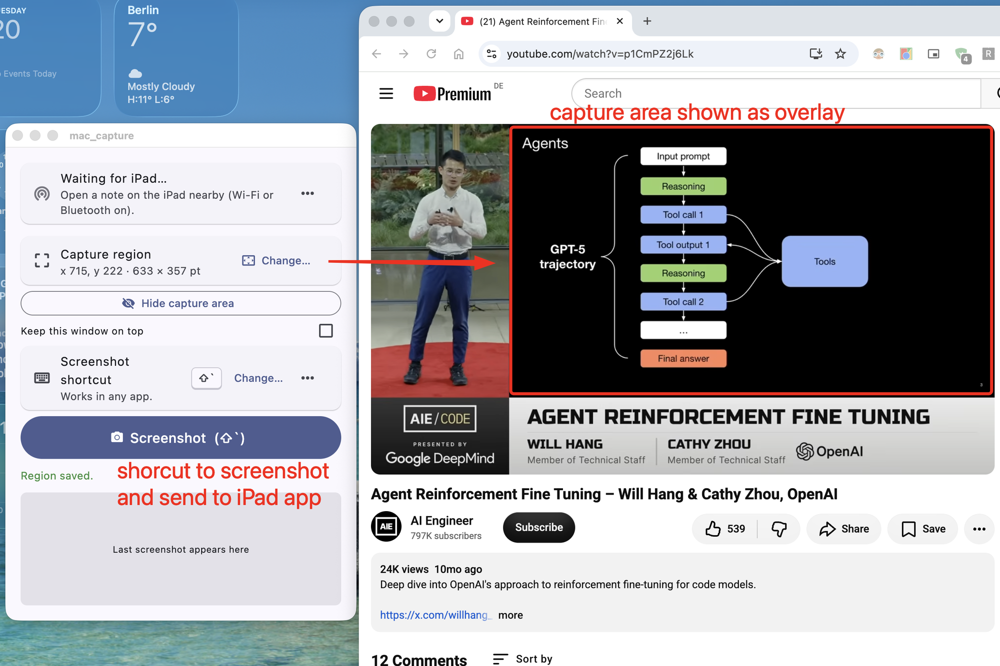
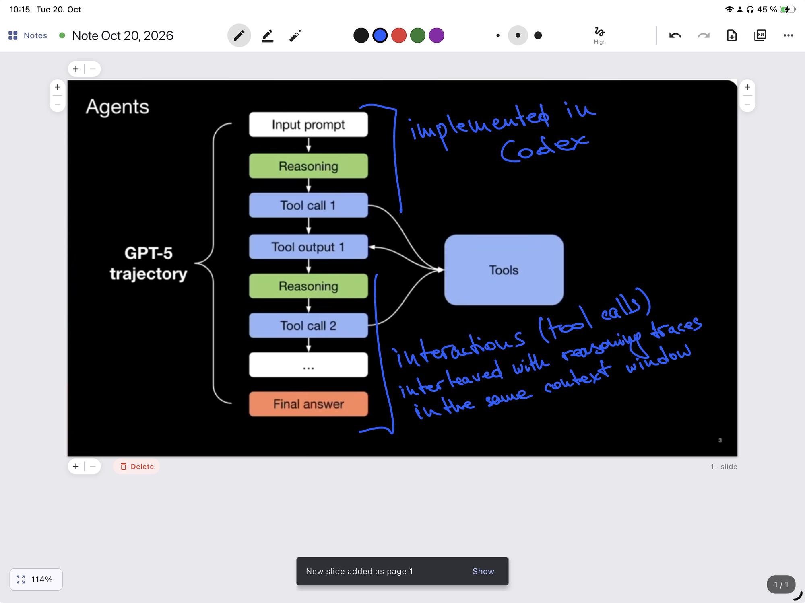
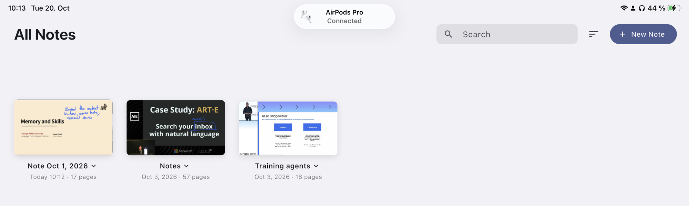
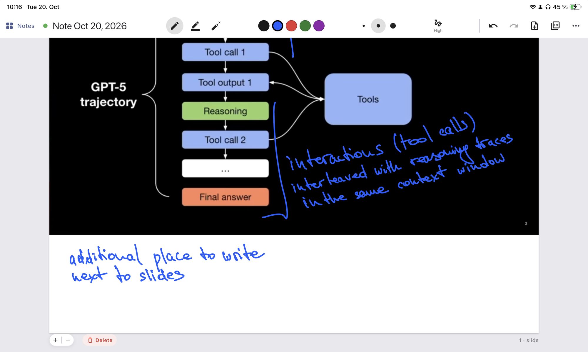
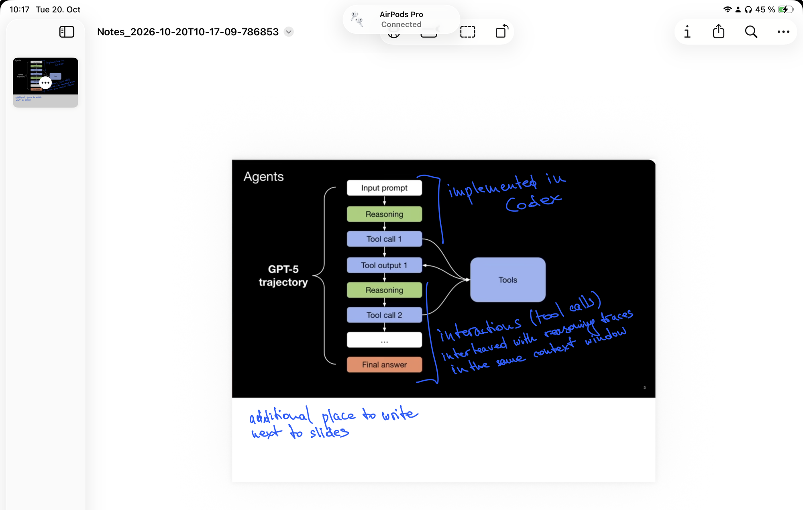

# Slide Notes — iPad & Mac

**Take handwritten notes directly on the slides of any presentation video, even when the
slides were never published. One keyboard shortcut is all it takes.**

### Why

Conference talks, lectures and tech presentations on YouTube almost never come with
downloadable slides. If you want to take notes on top of them, you're left pausing the video,
taking screenshots, cropping them and importing them into a notes app, one slide at a time.
Over a talk with tens or even hundreds of slides, that quickly becomes too tedious to keep up.

Slide Notes removes all of that. You mark the part of the screen where the presentation is shown
**once**. From then on, pressing a **single shortcut** while you watch captures exactly that area
and puts it on your iPad as a new page, ready to write on with the Apple Pencil. There's nothing
to crop, save or import, and you never have to leave the video.

It's made for:

- **Videos without public slides**, such as conference talks on YouTube, recorded lectures and
  webinars.
- **People who want to write directly on the slides** with little to no effort, instead of
  keeping notes in a separate document.

### What it is

Slide Notes is two apps that work together:

- **Slide Notes for Mac** (macOS) takes a screenshot of a region of the screen you choose,
  typically the slide area of a video player, but also a video call or a live presentation. You
  trigger it with one button or a system-wide keyboard shortcut (**⇧`** by default) without
  leaving the video.
- **Slide Notes for iPad** (iPadOS) is a notebook for the Apple Pencil. Every screenshot from
  the Mac shows up right away as a new page at the end of the open note. You annotate it, and you
  can export the whole note as a PDF.

The apps talk to each other directly over Apple's Multipeer Connectivity (the technology behind
AirDrop). There's no server, no IP address to enter and no shared Wi-Fi network needed.

<p align="center">
  
  <br>
  <em>Slide Notes for Mac (left) with the capture region outlined on a lecture video (right).
  Press <b>Screenshot</b> or <b>⇧`</b> to send the framed slide to the iPad.</em>
</p>

<p align="center">
  
  <br>
  <em>…and a moment later it's a new page on the iPad, ready to annotate with the Apple Pencil.</em>
</p>

> **Status:** proof of concept. Both apps are built with Flutter; platform features (screen
> capture, global hotkey, peer-to-peer link, Apple Pencil double-tap) are implemented natively
> in Swift.

> **Local only — you need both a Mac and an iPad.** Slide Notes currently works only
> between a Mac and an iPad that are physically near each other, connected directly over
> Multipeer Connectivity. There is no cloud sync, web version or remote access, and neither app
> is useful on its own: the Mac app has nowhere to send slides without the iPad, and the iPad
> app only receives slides from the Mac app. Both apps are built from source (they are not on
> the App Store).

---

## Contents

- [How it works](#how-it-works)
- [Features](#features)
- [Complete feature list](#complete-feature-list)
- [Requirements](#requirements)
- [Building & installing](#building--installing)
- [Usage](#usage)
- [Architecture](#architecture)
- [Project structure](#project-structure)
- [Data storage](#data-storage)
- [Testing](#testing)
- [Permissions & privacy](#permissions--privacy)
- [Known limitations](#known-limitations)

---

## How it works

```
┌──────────────── Mac ────────────────┐                      ┌──────────────── iPad ───────────────┐
│  Slide Notes for Mac            │                      │  Slide Notes for iPad           │
│                                     │   Multipeer          │                                     │
│  1. Pick a screen region (once)     │   Connectivity       │  4. Slide is appended as the last   │
│  2. Press Screenshot or ⇧`          │   (encrypted,        │     page of the open note           │
│  3. PNG is queued and sent ─────────┼──────────────────────┼──▶  — your scroll position doesn't  │
│                                     │   peer-to-peer       │     change                          │
│                                     │   Wi-Fi / Bluetooth) │  5. Annotate with the Apple Pencil  │
│                                     │                      │  6. Export the note as a PDF        │
└─────────────────────────────────────┘                      └─────────────────────────────────────┘
```

1. In the Mac app you choose the part of the screen to capture once. It is remembered and works
   on any connected display.
2. Each time you press **Screenshot** or the shortcut, that region is captured at full Retina
   resolution.
3. The slide is pushed to the iPad that has a note open. If no iPad is connected, slides wait in
   a queue and are delivered in order once one connects.
4. The iPad adds the slide as a new page at the end of the note. **It never moves your view**:
   if you are annotating page 3, you stay on page 3, and a small notification offers to jump to
   the new slide.

---

## Features

### iPad app

<p align="center">
  
  <br>
  <em>The notes library: each note shows its first slide, including handwritten annotations,
  with its date and page count.</em>
</p>

| Area | Details |
|------|---------|
| **Writing** | Apple Pencil draws and fingers scroll. Pen, highlighter and stroke eraser; 5 colors and 3 widths per tool; the Pencil's eraser end erases where supported. |
| **Ink smoothing** | Five levels (Off → Max): steadies the line while you write and smooths each stroke once you lift the Pencil. |
| **Pencil gestures** | Double-tap (Apple Pencil 2nd gen / Pro) switches between the eraser and the previous tool. |
| **Navigation** | Pinch to zoom (50–400 %), centered on your fingers; drag to pan when zoomed in. Page indicator. You can scroll past the last page until its bottom edge reaches the top of the screen. |
| **Page layout** | **+ / −** buttons on every page edge add or remove white space for notes beside a slide. − only removes white space, never part of the slide. |
| **Pages** | Add blank pages. Delete pages (undoable) into a per-note **recycle bin**, where they can be restored or removed for good. Unlimited undo / redo. |
| **Notes library** | Notability-style home screen: every note as a card with a preview of its first slide, title, date and page count. Search, sort (modified / created / title), create, rename, duplicate, delete. |
| **PDF export** | Exports the note as a PDF: slides as images, ink as sharp vector paths. Opens the system share sheet. |
| **Adaptive toolbar** | One row in landscape. In portrait or Split View the drawing tools move to a second full-width row, so nothing is hidden. |
| **Persistence** | Autosaves continuously. The note that was open when the app closed reopens on launch. |

<p align="center">
  
  <br>
  <em>Extra room for notes: <b>+</b> on any page edge adds white space next to the slide
  (here below it), and <b>−</b> takes it away again without ever cutting into the slide.</em>
</p>

<p align="center">
  
  <br>
  <em>PDF export: the same page as a PDF, with the slide, the extra space and every annotation
  kept. The ink is exported as sharp vector paths.</em>
</p>

### Mac app

| Area | Details |
|------|---------|
| **Region selection** | Dims every display; drag a rectangle (Esc or right-click cancels). Works across multiple monitors. |
| **Region outline** | Optional red frame around the capture area, drawn just outside it so it never shows up in screenshots. |
| **Capture** | Native Retina resolution. If the app's own window overlaps the region, it is hidden briefly during the capture. |
| **Global shortcut** | **⇧`** by default; works while any app is in front. You can record another shortcut, turn it off, or reset it. A soft sound confirms each capture. |
| **Delivery** | Slides are numbered, sent in order, and queued while no iPad is connected. |
| **Pairing** | The first connection from an iPad must be approved; after that the iPad is trusted. Trusted iPads can be forgotten. |
| **Window** | Optional "Keep this window on top". Shows a preview of the last screenshot. |

---

## Complete feature list

### iPad app: writing & drawing

- [x] **Pen** in **5 colors**: black, blue, red, green, purple
- [x] **Highlighter** in **5 colors**: yellow, green, pink, blue, orange. It is semi-transparent
      and always sits under pen ink, so text stays readable
- [x] **3 stroke widths** each for the pen and the highlighter (thin, medium, thick)
- [x] **Object eraser**: removes every whole stroke it touches, not just part of one
- [x] **Pencil eraser end**: flipping the Apple Pencil erases on models that support it
- [x] **Pencil double-tap** (Apple Pencil 2nd gen / Pro) switches between the eraser and the
      previous tool
- [x] **Ink smoothing** in 5 levels (**Off · Low · Medium · High · Max**). It steadies the line
      while you write and smooths each stroke when you lift the Pencil. The level is remembered
- [x] **Undo / redo** without limit, for handwriting, erasing, page resizing and page deletion
- [x] **Draw with finger** (⋯ menu) for the Simulator or writing without a Pencil. While it is
      on, fingers draw instead of scroll
- [x] **Palm-friendly input**: by default only the Apple Pencil draws, and fingers scroll and zoom

### iPad app: pages & navigation

- [x] **Slides from the Mac** are appended as the last page, without moving your view.
      A notice offers **Show** to jump to the new slide
- [x] **Extra writing space**: **+ / −** on every page edge (top, bottom, left, right) add or
      remove white space beside a slide. **−** never cuts into the slide
- [x] **Blank pages** can be added from the toolbar
- [x] **Delete pages**: undoable right away via the notice or undo
- [x] **Recycle bin** per note (⋯ › Recycle bin): every deleted page is kept there, can be
      **restored** to where it was, or **deleted forever**
- [x] **Pinch to zoom** from 50 % to 400 %, centred on your fingers; drag to pan; tap the %
      chip to reset
- [x] **Page indicator** (e.g. "3 / 12") and page numbers that mark which pages are slides
- [x] **Scroll past the last page** until its bottom edge reaches the top of the screen
- [x] **Adaptive toolbar**: one row in landscape, a second full-width tool row in portrait or
      Split View, so no tool is ever hidden

### iPad app: organising notes

- [x] **Notes library** with a card for every note: preview of the first slide, title,
      last-modified date and page count
- [x] **Custom note titles**: rename from the library or by tapping the title in the editor.
      New notes are named after the date (e.g. "Note Oct 20, 2026")
- [x] **Search** notes by title
- [x] **Sort** by date modified, date created, or title
- [x] **Duplicate** and **delete** notes (long-press a card, or tap ⌄ next to its title)
- [x] **Reopens the last note** on launch
- [x] **Autosave**: every change is saved automatically, with crash-safe writes

### iPad app: export

- [x] **Export to PDF** through the share sheet (save to Files, AirDrop, Mail, …). Slides are
      embedded as images and ink as sharp vector paths, with the extra page space included

### Mac app

- [x] **Select a capture region** by dragging over a dimmed screen. Works on every connected
      display; Esc or right-click cancels. The region is remembered
- [x] **Show / hide the capture area** as a red frame that never appears in screenshots
- [x] **Screenshot button** captures at full Retina resolution, and briefly hides the app's own
      window if it overlaps the region
- [x] **Global shortcut**, **⇧`** by default, works in any app
- [x] **Custom shortcut**: record any combination with ⌃ ⌥ ⇧ ⌘, or an F-key. It can be turned
      off or reset, and the app warns if another app already uses it
- [x] **Sound feedback**: a soft "tink" when a slide is sent, the alert sound if it failed
- [x] **Direct, encrypted link to the iPad**; no server or shared network needed
- [x] **Pairing approval**: each new iPad must be allowed once. Trusted iPads can be forgotten
- [x] **Delivery queue**: slides taken while no iPad is connected are sent in order once one is
- [x] **Keep this window on top** option and a **preview** of the last screenshot

---

## Requirements

You need **both devices**. Slide Notes is a local, two-device setup: the Mac captures and
the iPad receives, over a direct Multipeer connection.

| | Version |
|---|---|
| Mac | macOS 10.15 or newer, for running the Mac app *and* for building both apps |
| iPad | iPadOS 15 or newer; Apple Pencil recommended (finger drawing also works) |
| Flutter | 3.41 or newer (Dart 3.11) |
| Xcode | Current release, with command-line tools and CocoaPods |
| Apple ID | A signing team in Xcode; a free personal team works |
| Connectivity | Wi-Fi and/or Bluetooth switched on on both devices. They must be **near each other**, but don't need to be on the same network |
